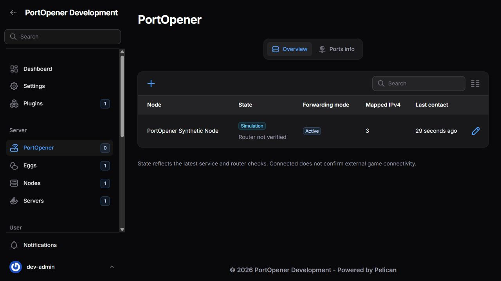
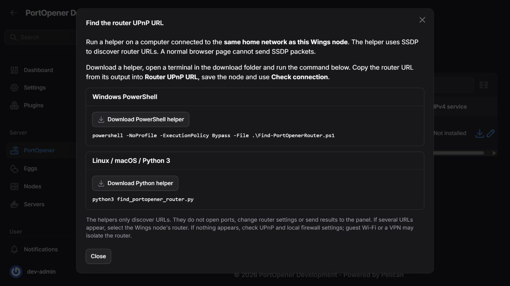

# PortOpener

Automatic, administrator-approved TCP/UDP forwarding for Pelican allocations.

PortOpener runs one securely paired PortOpenerService per Wings node. Administrators approve each allocation and its TCP/UDP protocol; server owners see forwarding status. The panel and Wings hosts may be on different Internet connections. Managed Egg deployment is IPv4-only; the host service also supports experimental, opt-in IPv6.

Version **0.6.4** consistently names the Python component, configuration, code and host package PortOpenerService. Original project code is MIT licensed. The tested baseline is Pelican 1.0.0-rc.1, plugin API 1, Linux and a FRITZ!Box 6591 Cable. See [validation and remaining launch checks](docs/VALIDATION.md) and [managed Egg verification](docs/IPV4-VERIFICATION.md).

## Where to find everything

| Location | Purpose |
| --- | --- |
| Admin → Server → PortOpener → Overview | Node connection state, forwarding mode, last contact and Configure |
| Admin → Server → PortOpener → Ports info | Detailed server/port/protocol and IPv4/IPv6 forwarding results |
| Admin → Server → PortOpener | Full allocation management, protocols and public access |
| Server owner → Network | Read-only PortOpener status, respecting hidden ports |

Node/router configuration, protocol choices, public-access modes and IPv6 approval are administrator-only. Hiding controls is backed by authorization checks on every mutation.



## Requirements

- A compatible Pelican panel with its scheduler and queue worker running.
- Docker Engine/Compose or a managed Python service on each Linux Wings host.
- A stable host LAN IPv4 and an UPnP IGD router. On FRITZ!Box, allow independent port sharing for the host.
- A panel HTTPS address with a trusted certificate for outbound pairing.
- The game listener, Docker port publishing and host firewall must already permit the game traffic.

The plugin does not change host firewalls, manage DNS or bypass ISP CGNAT/DS-Lite restrictions. PCP is not supported. Router mappings do not prove external game connectivity.

## Installation

For IPv4-only operation, import the plugin ZIP, save the node configuration, then click **Install IPv4 service** in the PortOpener overview. The plugin registers the Egg, hosts the checksum-verified service ZIP, creates one administrator-owned server per node and pairs it through Wings. **Reinstall IPv4 service** reuses the same server and preserves credentials, configuration and mapping state. See [managed IPv4 Egg installation](docs/IPV4-EGG.md) for prerequisites and recovery. Existing host-service deployments require an explicit handover before switching.

Back up the panel database and environment before installing or upgrading.

1. Import `dist/port-opener-0.6.4.zip` under **Admin → Plugins**, then install/enable Port Opener.
2. For host deployment (including IPv6), extract `port-opener-service-0.6.4.tar.gz` on the Wings host. The archive contains PortOpenerService and host deployment helpers.
3. Open **Admin → Server → PortOpener → Add node**. Select an existing Wings node, enter the router's UPnP description URL and the Wings host LAN IPv4. Start in **Test mode**. Save.
4. Open **Configure → Service connection and maintenance** for that node. Generate a one-time pairing code and run the displayed pairing command on the Wings host.

Example fresh service directory:

```bash
sudo mkdir -p /opt/PortOpenerService
sudo tar -xzf port-opener-service-0.6.4.tar.gz \
  --strip-components=1 -C /opt/PortOpenerService
cd /opt/PortOpenerService
python3 port_opener.py pair --panel https://panel.example.com \
  --credentials /opt/PortOpenerService/credentials/credentials.json \
  --config /opt/PortOpenerService/service.json
```

Enter the code in the private prompt. Codes expire after ten minutes and work once. The panel's configured public URL must be a valid HTTPS origin.

For Docker, use `credentials_file: /credentials/credentials.json` and `state_file: /state/state.json` in the service JSON. Give the credential directory/files to service UID 10001, with directory mode 700 and file mode 600. Then start:

```bash
sudo docker compose -f compose.outbound.yml up -d --build
```

Keep the ownership volume, installation UUID and protected credentials during upgrades. The service connects outbound to the panel and verifies its existing HTTPS certificate. No incoming service API port or separate service certificate is needed.

Credentials last 30 days and renew automatically. **Reconnect service** replaces credentials and requires pairing again. **Revoke credentials** stops authenticated updates and renewal; it does not immediately delete existing router rules. Pause forwarding and verify cleanup first when closure is needed.

## Node configuration

The Overview is the node list. Use the **+** button at its top left to add a node, the search field to find a node by name, and the **pencil** button to configure it. Router addresses and advanced fields stay inside the configuration popup.

The **PortOpener** menu entry is in the **Server** group. Its badge counts services with fresh contact and a working router. Offline, unpaired, simulated, pending-configuration and error states are excluded. The count covers all configured nodes, independently of the current search.

**Ports info** shows one section per server, with its allocated ports, protocols and forwarding states underneath. Its header has one pencil button opening the server's admin PortOpener tab. Search checks server names, nodes, addresses and nested port numbers; a matching server retains its other ports for context. Node, protocol and state filters narrow the child rows. Deleted-server observations remain visible without an edit button.

- **Paused:** requests closure of managed ports while keeping the service connected for cleanup.
- **Test mode:** checks approved ports and router conflicts without opening or renewing ports. Switching from Active first closes managed ports.
- **Active:** permits forwarding for servers whose public access is enabled.

Switching from Active to Test mode drains the old rules first. **Closing ports** stays visible until the service acknowledges the latest empty snapshot and IPv6 leases have expired. Cleanup failures remain visible; saving a setting is not a claim that rules are removed.

**Check connection** queues a read-only router check. Connected means fresh service/router communication, not proven game reachability. Simulation is explicitly labelled; fake-backend results never prove real router health. Stale reports and router/mapping failures cannot show healthy forwarding.

Advanced configuration contains port bounds, lease/reconcile intervals and legacy API settings. The service's pinned destination/range and any local preview lock remain authoritative. Clean up before changing router or host destination. Expanding local limits requires an operator to update the service configuration.

### Find the router URL

Beside **Router UPnP URL**, choose **Find router URL**. Download the PowerShell helper for Windows or the Python 3 helper for Linux/macOS and run the displayed command on a computer on the **Wings node's router LAN**. The helper sends read-only SSDP discovery requests and prints supported private IPv4 device-description URLs. Paste a URL into the node configuration, save and use **Check connection**. No results are uploaded automatically and no router settings or port mappings are changed.

SSDP multicast does not normally cross routers, guest-network isolation or VPNs. If several adapters are present, use `-InterfaceAddress 192.168.178.20` (PowerShell) or `--interface 192.168.178.20` (Python), substituting the discovery computer's own LAN IPv4. Discovery lists IGD2 before IGD1. PortOpenerService prefers WANIPConnection:2, with WANIPConnection:1 and WANPPPConnection:1 as fallbacks. For FRITZ!Box, either standard description URL tries `/igd2desc.xml` first, then `/igddesc.xml`, on the same configured origin. Other router URLs stay exact. Read-only discovery verifies the selected interface before writes; the overview displays IGD2 or IGD1 after a fresh service report. Unsupported or unavailable discovery/read operations may fall back; permission failures and unsafe endpoints remain errors. Mapping writes are never repeated automatically through another interface when their outcome is uncertain. A normal browser page cannot send SSDP UDP multicast, so the helper runs locally rather than inside the page. See [Chrome's Direct Sockets documentation](https://developer.chrome.com/docs/iwa/direct-sockets) and the [UPnP discovery specification](https://upnp.org/specs/arch/UPnP-arch-DeviceArchitecture-v2.0-20140901.pdf).



## Configure a server

During server creation, the **PortOpener** wizard step offers a protocol for each selected allocation. New choices default to **Not managed**; creating a server does not enable public access.

For an existing server, open **Admin → Servers → Edit → PortOpener**.

The plugin reuses Pelican's actual allocation manager, including:

- Add unassigned allocations or create allocations/port ranges.
- Display addresses/ports, edit aliases and notes.
- Show/hide the port from the owner's view.
- Set the primary allocation, lock/unlock and remove allocations.
- Select **Not managed**, **TCP**, **UDP** or **TCP + UDP** for each allocation.

Aliases and notes are descriptive. They no longer select forwarding rules. Locking prevents owners from deleting allocations; it does not disable forwarding. Native table edits save using Pelican's normal behavior; forwarding settings have their own Save button.

Public access is **Off**, **Only while running** or **Always**. Turning it on requires at least one valid protocol choice and an enabled node. Running-only mode polls Wings, waits for confirmed running and allows 120 seconds of restart grace. Unknown runtime retains only previously requested ports that are still approved; revoking a protocol or removing an allocation still requests cleanup.

Allocation approvals are pinned to server, node, address and port. Bulk release/reassignment invalidates them immediately, including release-and-reassign round trips. A new assignment never inherits the previous server's forwarding approval.

### Valheim example

Assign allocations 2456 and 2457. Set each forwarding protocol to **UDP**, then choose a public-access mode. No query-port egg variable or alias rule is required. Use a client outside the home network to verify the game/Steam browser.

### Owner status

Owners see the current protocol/forwarding state on Network. Hidden ports stay hidden. Protocol, public-access and IPv6 mutations are rejected by the backend even if an owner submits a direct request. Existing Pelican allocation permissions remain separate from the plugin's admin-only forwarding policy.

## Optional IPv6

IGD2 also defines IPv6 firewall control, which is separate from IPv4 NAT forwarding. Selecting IGD2 does not enable IPv6, resolve router permission failures or add IPv6 support to the IPv4-only Egg. The host deployment is required for IPv6.

IPv4 is the default. In the node dialog enable IPv6, optionally select a host interface, and approve IPv6 separately in the server's admin PortOpener tab.

The service selects a non-temporary global IPv6 locally, excluding ULA, link-local, tentative and deprecated addresses. It verifies the IPv6 gateway identity against the configured router and follows address changes. Ambiguous addresses and missing IPv6 listeners block pinholes. DNS remains externally managed.

IPv6 uses finite 120-second pinholes renewed by their exact destination/port/protocol tuple. Approval removal, listener loss or address changes stop renewal; old leases remain visible for about 125 seconds. ID-only renewal/deletion is avoided because router IDs may be reused and this API cannot inspect a pinhole's tuple.

Our FRITZ!Box accepts AddPinhole but denies read-back, including source-bound IPv6 requests. Those rules show **Requested (unverified)**. External IPv6 traffic has not been independently verified.

## Diagnostics and temporary debug mode

Open the node's **Configure > Diagnostics** section. **Download diagnostics** exports a JSON support report with versions, numeric policy limits, cached connectivity/port status and recent service events. Addresses, URLs, server/node names, installation identities, credentials, environment files, raw requests and exception messages are excluded. Only root administrators can download reports or control debug mode. Nothing is uploaded to a third party automatically.

Choose **Enable debug (15 minutes)**, wait for the next service poll, reproduce the issue, then download the report. **Stop debug** requests an earlier stop. The service enforces its own deadline, including during a panel outage, and a monotonic deadline prevents a backwards clock adjustment from prolonging the current session. Status distinguishes a panel request from the service's last reported debug state.

Normal events record changes, failures and recovery. Debug adds repeated per-port checks and successful report delivery. History is capped at 128 events and 64 KiB on disk, with private file permissions. Events also appear in the service console. If the service cannot report, the download contains cached/absent service data; local sanitized history remains beside its state file as `state.json.diagnostics.json`. Review the report before choosing to share it.

## Operations and cleanup

Before stopping/uninstalling the plugin or service:

```bash
# Panel directory, as its application user:
php artisan port-opener:sync --cleanup
```

Wait for confirmed removal, including finite IPv6 expiry. Keep ownership state and retry if cleanup fails. Pelican's plugin disable action has no cleanup hook: cleanup first, disable second.

```bash
# Service directory:
sudo docker compose ps
sudo docker compose logs --tail 50
# Panel:
php artisan port-opener:sync --dry-run
php artisan port-opener:sync
```

Back up plugin tables, service configuration, credentials and durable state. Never remove unrelated router rules to resolve conflicts. The UI update does not require restarting game servers or changing Wings.

See [validation](docs/VALIDATION.md), [operations](docs/OPERATIONS.md) and [development](docs/DEVELOPMENT.md). Development uses isolated volumes, synthetic servers and a fake router. Native screenshots depict development rather than live-router reachability.

## License and source publication

Original project code and documentation use the [MIT license](LICENSE), copyright 2026 Icesory. See [third-party notices](THIRD_PARTY_NOTICES.md). For a fresh public repository, use the reviewed [file list](packaging/public-files.txt) and [publication guide](docs/PUBLICATION.md); do not copy private development history or runtime files. The two included screenshots show synthetic development data and illustrate navigation; wording may differ from the current release.
